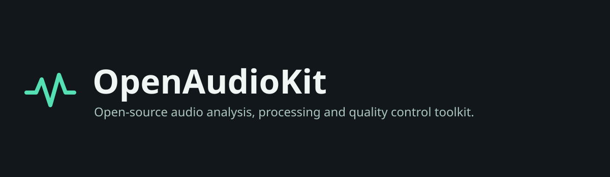
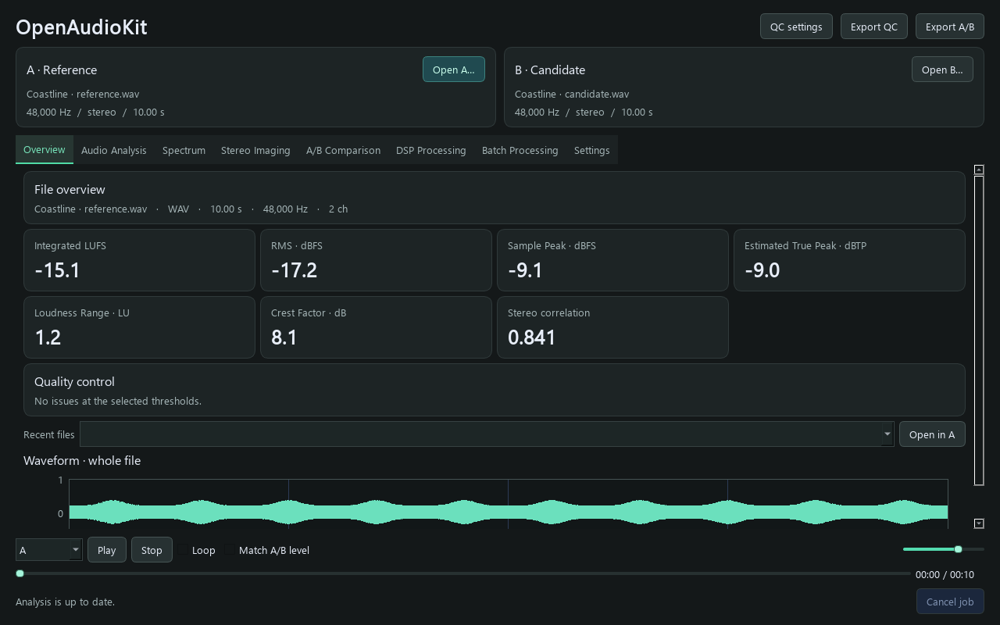

# OpenAudioKit



OpenAudioKit is an MIT-licensed Python toolkit for offline audio measurement, DSP and quality control for producers, engineers, researchers and developers. It can check individual deliverables, compare two masters or run a repeatable processing chain over a directory of recordings.

[Leia em português](README.pt-BR.md) · [Installation](docs/installation.md) · [Python API](docs/python-api.md) · [Measurement methods](docs/measurement.md)

## Install from source

```sh
python -m pip install -e ".[cli]"
```

Use `python -m pip install -e .` for the Python library. Add `gui` for the PyQt6 desktop application or `api` for the FastAPI server. OpenAudioKit requires Python 3.10 or later.

## Desktop



Open two recordings for visual and audible A/B comparison with optional level compensation. Review a DSP chain against a rendered preview before exporting. [Desktop guide](docs/desktop.md)

## Run a workflow

```sh
python examples/generate_tone.py demo.wav
openaudiokit analyze demo.wav
openaudiokit normalize demo.wav normalized.wav --lufs -23 --ceiling -1
openaudiokit compare demo.wav normalized.wav --output comparison.json
openaudiokit process demo.wav processed.wav --preset examples/cleanup.json
openaudiokit batch demo.wav normalized.wav --preset examples/cleanup.json --output-dir output
openaudiokit report normalized.wav qc.html --expected-sample-rate 48000
```

Launch the desktop with `openaudiokit-gui` or the loopback REST server with `openaudiokit-api`. The server exposes interactive documentation at `http://127.0.0.1:8000/docs`.

## Use as a library

```python
from openaudiokit import load_audio
from openaudiokit.qc import inspect
from openaudiokit.report import write_report

report = inspect(load_audio("demo.wav"))
print(report.metrics.loudness.integrated_lufs)
write_report("qc.json", report)
```

- Measure levels, dynamics, clipping, silence, channel balance and stereo correlation. Compute FFT, STFT, spectrograms, power-weighted descriptors and transient candidates.
- Apply gain, normalization, Butterworth filters, notch, parametric EQ, linked dynamics, fades, resampling and channel routing.
- Export JSON, CSV or static HTML and report sample-rate mismatches against a configured delivery target.

The library stores decoded audio in memory. Selected measurements use bounded working buffers. K-weighted loudness is limited to mono and stereo at 8 kHz and above. True peak is an oversampled estimate. See the measurement notes for windowing, gates and validation scope.

See [contributing](CONTRIBUTING.md), [security reporting](SECURITY.md), [roadmap](ROADMAP.md) and [release instructions](docs/releasing.md).

Read the [architecture](docs/architecture.md), [REST API](docs/rest.md), [scientific audit](docs/scientific-audit.md), and [release checklist](docs/release-checklist.md). The original code uses the [MIT license](LICENSE).
