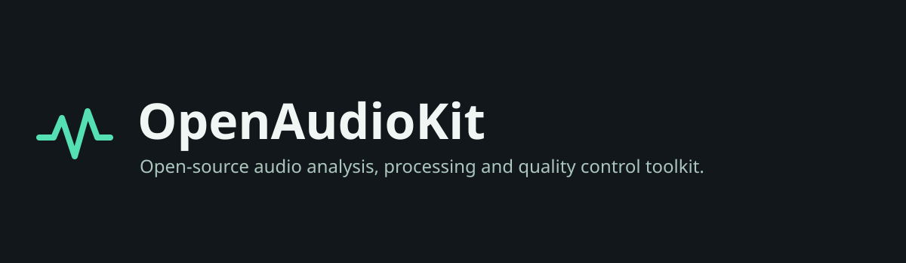
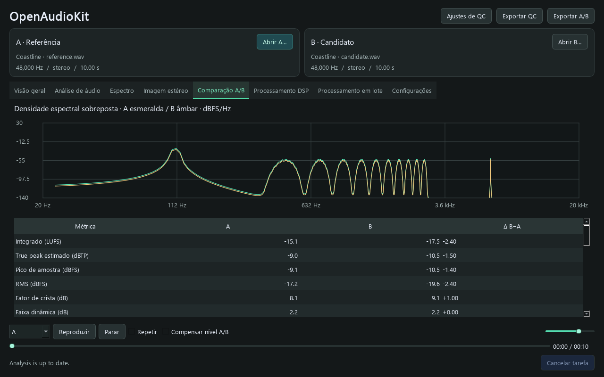

# OpenAudioKit



OpenAudioKit é uma biblioteca Python com licença MIT para medir, processar e verificar áudio digital offline. Destina-se a produtores, engenheiros, pesquisadores e desenvolvedores. Use-a para inspecionar arquivos antes de uma entrega, comparar duas versões de uma mixagem ou aplicar a mesma cadeia de DSP a vários arquivos.

[Read in English](README.md) · [Instalação](docs/installation.md) · [API Python](docs/python-api.md) · [Métodos de medição](docs/measurement.md)

## Instalação pelo código-fonte

```sh
python -m pip install -e ".[cli]"
```

Para instalar só a biblioteca, use `python -m pip install -e .`. Inclua o extra `gui` para a interface PyQt6 ou `api` para o servidor FastAPI. O projeto requer Python 3.10 ou superior.

## Desktop



Compare duas gravações visualmente e pelo player, com compensação opcional de loudness. Renderize uma prévia para ouvir os efeitos de uma cadeia DSP antes de exportar. [Guia desktop](docs/desktop.md)

## Primeira análise

```sh
python examples/generate_tone.py demo.wav
openaudiokit analyze demo.wav
openaudiokit normalize demo.wav normalized.wav --lufs -23 --ceiling -1
openaudiokit compare demo.wav normalized.wav --output comparison.json
openaudiokit process demo.wav processed.wav --preset examples/cleanup.json
openaudiokit batch demo.wav normalized.wav --preset examples/cleanup.json --output-dir output
openaudiokit report normalized.wav qc.html --expected-sample-rate 48000
```

A interface `openaudiokit-gui` exibe waveform, espectrograma, medidores e comparação visual A/B. O servidor local `openaudiokit-api` oferece documentação interativa em `http://127.0.0.1:8000/docs`.

- A análise inclui RMS, pico, estimativa de true peak, loudness, faixa dinâmica, clipping, DC offset, silêncio e correlação estéreo.
- O núcleo calcula FFT, STFT, espectrograma, bandas de energia, descritores espectrais e candidatos a transientes. O DSP oferece ganho, filtros, EQ, dinâmica, fades, resampling e roteamento de canais.
- O controle de qualidade usa limites configuráveis. Os relatórios em JSON, CSV e HTML registram as medições e as ocorrências detectadas.

O áudio decodificado fica em memória. Algumas medições limitam os buffers de trabalho. Loudness K-weighted exige áudio mono ou estéreo com taxa de pelo menos 8 kHz. A documentação explica as janelas, os gates e o alcance da validação.

Consulte o [guia de contribuição](CONTRIBUTING.md), a [política de segurança](SECURITY.md) e as [instruções de publicação](docs/releasing.md).

## Uso em Python

```python
from openaudiokit import load_audio
from openaudiokit.qc import inspect
from openaudiokit.report import write_report

report = inspect(load_audio("demo.wav"))
write_report("qc.json", report)
```

Consulte o [guia em português](docs/pt-br.md), a [arquitetura](docs/architecture.md), a [API REST](docs/rest.md) e a [auditoria científica](docs/scientific-audit.md). O código original usa a [licença MIT](LICENSE).
