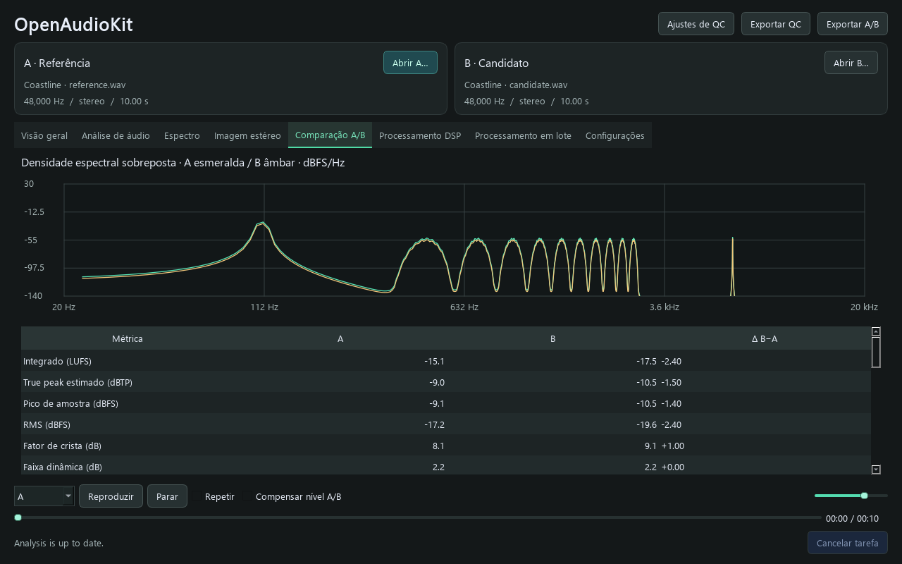

# Aplicativo desktop

Instale o extra PyQt6 e execute o aplicativo em uma sessão gráfica.

```console
python -m pip install -e ".[gui]"
openaudiokit-gui
```

Em **Settings**, selecione **Português** para adaptar a interface. As legendas dos relatórios exportados e as chaves dos presets seguem a API Python.



## Importar, medir e comparar

Abra a referência em A e a outra versão em B. Você também pode soltar um arquivo local sobre a janela para abri-lo na origem ativa. A **Visão geral** exibe o contêiner, a duração, os canais, a taxa de amostragem, a forma de onda, os níveis e os alertas fundamentados nos limites de QC. O histórico recente guarda dez caminhos já abertos no computador. Use **Ctrl+O** para abrir A, **Ctrl+Shift+O** para abrir B e **Ctrl+E** para exportar o relatório QC.

- **Análise de áudio** traz forma de onda, histórico de loudness e máximos do arquivo. Clique na onda para buscar, use a roda para zoom, Shift+roda para deslocar e Shift+arraste para selecionar.
- **Espectro** mostra densidade espectral média em dBFS/Hz, espectrograma linear ou logarítmico e frações de energia por banda.
- **Imagem estéreo** mostra um goniômetro com Side no eixo X e Mid no Y, além da correlação no arquivo.
- **Comparação A/B** mostra espectros sobrepostos e diferenças B−A. O botão **Exportar A/B** salva as medições da comparação em JSON, CSV ou HTML.

A barra inferior seleciona A, B e a prévia processada, além de oferecer reprodução, pausa, parada, busca, volume e loop. A compensação de nível atenua a fonte mais alta na reprodução quando as medições integradas de A e B estão disponíveis. Ela preserva o arquivo e as medições utilizadas nos relatórios. Os medidores na posição do player leem o trecho de PCM antes do cursor e as últimas janelas completas de loudness, antes do volume de reprodução.

## Processar e exportar

Em **Processamento DSP**, selecione e adicione os efeitos, depois ajuste a ordem da cadeia. Atualize um efeito selecionado para aplicar os parâmetros editados. O editor também carrega e salva presets JSON da CLI. Para escolher o filtro, escreva o tipo entre aspas, como `"highpass"` ou `"lowpass"`.

Renderize a prévia para ouvir a cadeia aplicada a A. Volte a selecionar A no player para ouvir o original. A opção **Ignorar cadeia** permite renderizar outra prévia com os efeitos desativados. Para exportar, escolha um destino distinto dos arquivos abertos. Os formatos WAV, FLAC, AIFF e OGG dependem dos codecs instalados e dos limites de cada codificação.

**Processamento em lote** executa a cadeia em vários arquivos e salva os WAVs e o relatório JSON na pasta escolhida. É possível cancelar entre arquivos ou efeitos e antes da gravação de relatórios. As saídas concluídas permanecem na pasta. A interface limita cada fonte e resultado processado a 32 milhões de amostras escalares. Reprodução e exportação dependem dos codecs disponíveis.
