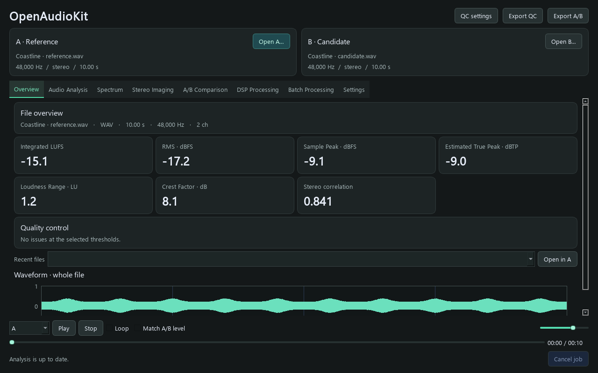
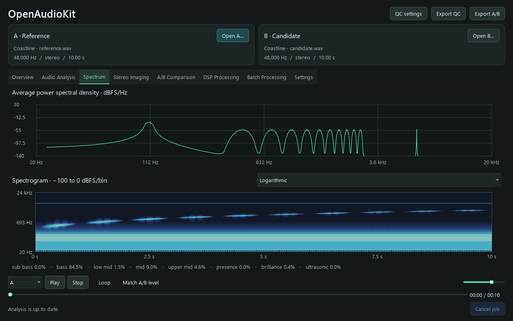

# Desktop application

Install the optional PyQt6 interface and start it from a desktop session.

```console
python -m pip install -e ".[gui]"
openaudiokit-gui
```



## Open and inspect

Drag a local recording onto the window or use **Open A** and **Open B**. The first file dropped opens in the currently selected slot. **Overview** shows the decoded container, duration, sample rate, channels, a waveform, seven levels and stereo metrics, and objective QC observations. Its recent-file list stores up to ten successful input paths locally. **Settings** changes the interface language and session QC thresholds.

| Page | Contents |
| --- | --- |
| Audio Analysis | Interactive waveform, file loudness histories, whole-file level maxima, and position-based levels. |
| Spectrum | Logarithmic average power spectral density, linear or logarithmic spectrogram, and relative band energy. |
| Stereo Imaging | Mid/Side goniometer and whole-file stereo correlation. |
| A/B Comparison | Overlaid spectra, measurements and B−A deltas. The toolbar exports the comparison. |
| DSP Processing | Ordered processing chain, JSON presets, rendered preview, and export. |
| Batch Processing | Apply the current chain to selected files and export a JSON job report. |

Switch pages with the tab strip. Use **Ctrl+O** to open A, **Ctrl+Shift+O** to open B and **Ctrl+E** to export the current QC report.



## Listen and compare

Use the player to play, pause, stop, seek, set volume, and switch among **A**, **B**, and the current **Processed** preview. In Audio Analysis, click the waveform to seek, scroll to zoom, Shift+scroll to pan, and Shift+drag to select a segment. Turn on **Loop** to repeat the selected segment or whole file. Switching sources carries the elapsed position when that position exists in the new file. The sources play at their own rates. Hardware and platform codecs determine playback support.

**Match A/B level** attenuates the louder source using the measured integrated loudness when both values are available. It changes playback gain and leaves the files and analysis intact. Reports describe the original file levels. QC thresholds and reference choices do not imply a universal target or a quality rating.

The playhead readings use up to 50 ms of decoded PCM immediately before the cursor and the latest completed 400 ms and 3 s loudness windows. These values describe source samples at the player's position, before playback volume or matching. They are distinct from whole-file levels and maxima. Waveform and goniometer plots are bounded visual summaries. The goniometer plots Side horizontally and Mid vertically. The spectrum samples up to 128 Hann periodograms across the recording and respects Nyquist. Spectrogram columns represent sampled time windows on long files.

## Render and export

Add effects in DSP Processing and edit their controls. Move effects to change evaluation order. Select an effect to update its stored parameters, or reset the editor to the selected effect's defaults. The filter kind accepts a quoted value such as `"lowpass"` or `"highpass"`. Use **Load preset** or **Save preset** to exchange the same JSON chain with the CLI.

**Render preview** processes the complete source A in a worker and opens a temporary WAV for listening. Select A to compare against the original or enable **Bypass chain** and render a fresh preview. Changing source A discards its earlier preview. Export the current preview as WAV, FLAC, AIFF or OGG, depending on the installed libsndfile and encoding limits. Destination validation protects open source paths. DSP preview uses offline renders and the current preview must be regenerated after editing parameters.

Batch processing uses the same chain and writes float WAVs and `batch-report.json` into the selected output directory. Cancellation is cooperative between files or effects and before report/export writes. Completed outputs remain on disk. A running analysis or codec operation may take time to return before cancellation takes effect.

Each desktop source and processed result is limited to 32 million decoded scalar samples, about 5 minutes 33 seconds of 48 kHz stereo. PyQt6 is distributed by Riverbank under GPL and commercial terms. The separately distributed OpenAudioKit source is MIT-licensed. [PyQt licensing](https://www.riverbankcomputing.com/software/pyqt/)

Reproduce the screenshots with `python examples/render_desktop_screenshots.py docs/assets` after installing the desktop extra.
